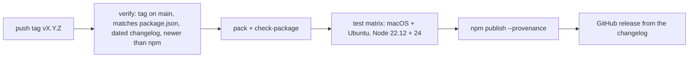

# Contributing

secure-input is a TypeScript plugin for Paseo 0.14.0-beta.1 and later, with a React Native client in the Paseo app (the pill, the form, the settings screen) and a Node.js half on the daemon (the tools, the requests, the sets in `drop/`). Changes must keep [SECURITY.md](SECURITY.md) true: no value in a tool result, a message, a pill, a status, an RPC answer, a log or a state file, and no sentence in a document that the code does not hold.

## Development setup

Use **Node.js 22.12.0 or newer** and npm, on macOS or Linux, as a user that is not root. From the repository root:

```sh
npm ci
npm run check        # typecheck the daemon half, the app half and the tests, then the full test suite
```

The tests use real files, directories and child processes, so they need `git` and `/bin/sh`, and they refuse to run as root: their permission cases need a user the kernel can refuse. The suite passes on macOS and on Linux; the plugin itself has been run on macOS only. Run one file while you work on it:

```sh
npm test -- tests/registry.test.ts
```

`npm run typecheck` checks three TypeScript projects. `tsconfig.server.json` holds the daemon half and the tests that load nothing of the app, with Node's types; `tsconfig.client.json` the app half, which runs on Hermes, with neither Node's types nor the DOM's; `tsconfig.client-tests.json` the tests that import modules of `client/`, which bring React Native's global types with them. A new test that imports `client/` goes in the third project and in the exclusions of the first: `tests/client-boundaries.test.ts` fails until it does.

The development SDK (`@getpaseo/*`) is pinned to 0.14.0-beta.1, the oldest release the manifest accepts, so typechecking proves the plugin uses only that API, and `tests/mirrored-constants.test.ts` holds the most one Paseo RPC may carry, which bounds a submission, to that release's protocol and relay. Server and client code must not import `@getpaseo/client` or `@getpaseo/protocol` directly, even for types: they are development dependencies and are absent from an npm installation. The plugin's runtime dependencies are `@noble/ciphers`, `@noble/curves` and `@noble/hashes`; Paseo supplies `zod`, `react`, `react-native` and `@tanstack/react-query` at runtime.

## The documents are tested

`tests/docs.test.ts` holds README.md, SECURITY.md, OVERVIEW.md and the skill to the code: every word of the app they quote in «…», the plugin's messages and refusals, the tool names, every number with a unit, the links, and the skill's recipes, which it runs with a value in a real file. The sentence that lists how a message to an agent can be lost must stay the same in README.md and SECURITY.md. When a document changes, change what the test claims of it in the same commit; never loosen the test to let a sentence pass. `tests/canary.test.ts` sends recognisable values through the tools and the whole plugin, and fails if one turns up anywhere but in the files in `drop/`.

## Changelog and releases

Versions follow [semantic versioning](https://semver.org). A pull request with a user-visible change adds an entry under `## Unreleased` at the top of `CHANGELOG.md`, in the `Added`, `Changed`, `Fixed`, or `Removed` group. The release notes are that section, so write entries for people who run the plugin.

To cut a release from an up-to-date `main`:

```sh
node scripts/release.mjs prepare minor   # or patch, major, premajor, preminor, prepatch, prerelease (beta id), or 1.2.3-beta.1
npm run check
```

`prepare` dates the Unreleased section, sets the version in `package.json` and `package-lock.json`, and prints the commit, push, and tag commands: `git commit -am "Release X.Y.Z"`, `git push origin main`, `git tag vX.Y.Z` and `git push origin vX.Y.Z`. The settings screen shows the version from `PLUGIN_VERSION` in `shared/limits.ts`, which `prepare` does not touch: set it, and the version `tests/mirrored-constants.test.ts` expects of it, to the new version before the commit, or `npm run check` fails. Pushing the `v` tag starts the [Release workflow](.github/workflows/release.yml):



Prereleases go to the `next` dist-tag and are marked as prereleases on GitHub. Versions only move forward: the workflow refuses a version below the newest one on npm, prereleases included.

If a run fails for a reason outside the tagged commit, such as npm settings or a flaky runner, fix it and run the workflow again from the same tag with `gh workflow run release.yml --ref vX.Y.Z`. A fix to the code needs a new version. A version already on npm, one published by hand included, is not published again; the run only completes the GitHub release.

Publishing uses npm trusted publishing, so the repository stores no npm token. The package's trusted publisher on npmjs.com names repository `dutchakdev/paseo-plugin-secure-input`, workflow `release.yml`, and environment `npm`. Keep that environment limited to `v*` tags in the repository settings, since npm does not check which ref a run started from.

`npm pack` and `npm publish` run `prepack`, which writes `npm-shrinkwrap.json`, and `postpack`, which deletes it. The shrinkwrap is the production part of `package-lock.json`, the three `@noble/*` packages: npm publishes it and honors it when Paseo installs the plugin, while `package-lock.json` is neither published nor read there. The Paseo plugin directory requires that lock for a package with runtime dependencies, and `scripts/check-package.mjs` rejects a tarball without it, or with what the plugin does not run from (`tests/`, `docs/`, `scripts/`, `.github/`). The shrinkwrap stays out of Git, because npm would prefer it to `package-lock.json` for development installs. If packing is interrupted, run `node scripts/shrinkwrap.mjs remove`.

The plugin directory on paseo.sh pins an npm version: once the plugin is listed, a new npm release reaches its listing through a bump pull request in [getpaseo/plugins](https://github.com/getpaseo/plugins), and the listing changes when a reviewer approves it. The listing text comes from `OVERVIEW.md` in the package; update it when setup or behavior changes, and keep install commands out of it: the directory rejects them, and so does `scripts/check-package.mjs`. Paseo Cafe expects npm's `latest` version to match `package.json` on `main`, so push the tag right after the release commit.

## Live validation

Run the checks, then reload the plugin rather than restarting the daemon:

```sh
paseo plugin reload secure-input
paseo plugin ls          # expect: running
paseo plugin logs secure-input
```

`running` covers the daemon half only. The app checks its own version before it runs the client half, so check the pill, the form and the settings screen in the app as well, on the desktop and on a phone, in light and dark themes, and press «Перевірити» on each. Use test values, never a real secret. Report automated checks separately from what you saw in the app.

## Issues and pull requests

For a bug, include the steps to reproduce it, what you expected and what happened, the plugin, Paseo daemon and app versions, the daemon's OS and the agent. Leave out every real secret, the content of any `si-secret-` file, private paths and host names. A vulnerability goes through the private report that [SECURITY.md](SECURITY.md#reporting) describes, not an issue.

Pull requests should explain the resulting behavior, the tests that hold it and the documents it changed, and say what was not checked live. Keep changes focused so they can be reviewed on their own.
