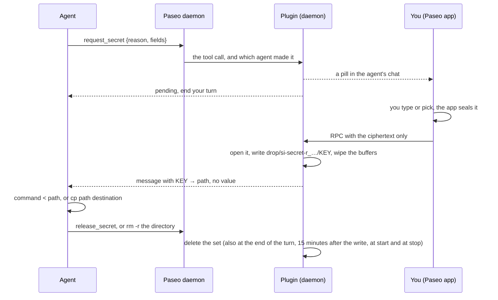

secure-input is a [Paseo](https://paseo.sh) plugin through which an agent asks you for a password, an API key, a token or a whole credentials file in a form in the Paseo app, instead of in the chat. The request is a pill in the agent's chat: a small button that names what is asked for and opens the form. What you enter is sealed in the app, opened on the daemon and written to a set: a short-lived directory with a file for each value, which only your OS user can read. The agent gets the files' paths, never the values, and moves each value where it belongs without reading it. The texts of the pill, the form and the settings screen are in Ukrainian only.

## Install

You need Paseo **0.14.0-beta.1 or later** in two places. The daemon runs the plugin's server half; the app, on the desktop and on the phone, loads the pill, the form and the settings screen, and checks the version on its own. `paseo plugin ls` showing `running` says nothing about the app: an older app shows no pill. Paseo 0.14.0-beta.1 is a pre-release: on 2026-10-28 npm had it under the Paseo CLI's `beta` dist-tag, and `latest` was still 0.13.2 (`npm view @getpaseo/cli dist-tags`). The desktop and phone apps you answer from must be on 0.14 too. Check both:

```bash
paseo daemon status          # daemonVersion
/usr/libexec/PlistBuddy -c 'Print :CFBundleShortVersionString' /Applications/Paseo.app/Contents/Info.plist   # the macOS app
```

The daemon's Node.js must be 22.12 or later. macOS and Linux are declared supported; the plugin is developed and run on macOS, and its tests pass on Linux too.

Plugins must be enabled daemon-wide first, under **Settings → Plugins → Enable plugins** (the root `pluginsEnabled` field in the daemon's `config.json`). Agents must also get Paseo's own tools, which bring this plugin's with them:

```bash
paseo daemon config set daemon.mcp.injectIntoAgents true
```

While `daemon.mcp.injectIntoAgents` is off, no agent has any of Paseo's tools, so none has this plugin's. A fresh home of Paseo 0.14.0-beta.1 has it off (whether an upgraded one has it on was not checked); setting it takes effect without a restart. An agent gets the tools when its session opens.

Then install the plugin from one of these sources:

| Source | Command |
|---|---|
| [Plugin directory](https://paseo.sh/plugins), the reviewed version, once the plugin is listed there | `paseo plugin add dutchakdev/secure-input` |
| npm, the newest release, also before the directory has reviewed it | `paseo plugin install npm:paseo-plugin-secure-input` |

`paseo plugin ls` should then show `secure-input` as `running`. `paseo plugin update secure-input` pulls later releases from the same source, and `paseo plugin remove secure-input` stops and removes the plugin; its data directory stays ([Where things are](#where-things-are)). To run it from a checkout instead, see [Development](#development).

Then link the skill, which tells agents to use the form and how to move a value without reading it. Paseo hands no plugin's skill to agents, and the copy of the plugin it installs moves to a new directory at every update, so link the skill from a clone of this repository. Agents that read `~/.agents/skills` take it from there; Claude Code reads `~/.claude/skills`:

```bash
git clone https://github.com/dutchakdev/paseo-plugin-secure-input.git
cd paseo-plugin-secure-input
mkdir -p ~/.agents/skills ~/.claude/skills
ln -sn "$PWD/skills/secure-input" ~/.agents/skills/secure-input
ln -sn ../../.agents/skills/secure-input ~/.claude/skills/secure-input
```

`ln -sn` replaces nothing: where a name is already a file or a link, that line fails with `File exists`; where it is a real directory, the new link lands inside it, so look with `ls -ld` first. Links you made for v1 keep working, since the skill is at the same path. v1's second skill, `secure-input-setup`, is gone; remove its links (`rm` removes a link, not what it points to):

```bash
rm ~/.agents/skills/secure-input-setup ~/.claude/skills/secure-input-setup
```

Last, on every device you will answer from, open the plugin's settings screen, **Secure input**, and press «Перевірити». It seals the largest submission one request can carry in the app and has the plugin open it, the way a real value goes.

Use the app with the daemon over the relay or Tailscale. A direct LAN connection with a password is not encrypted ([SECURITY.md](SECURITY.md)).

## How it works



Nothing opens by itself: the request is a pill in the agent's chat, and the form opens when you press it. The agent says why it asks in its own message; the form shows no reason.

## The tools

Paseo serves four tools to every agent that has Paseo's tools. Each call carries the agent that made it, as the daemon names it from the agent's connection to its MCP server, and nothing the call itself says of who is asking. On Paseo 0.14.0-beta.1 that name is not bound to a credential: it keeps agents apart that use the connection Paseo gave them, and not a process that can reach the daemon's MCP endpoint for agents and calls it as another agent. On a daemon with no password that takes no credential at all; on one with a password, the token Paseo puts in the configuration of every agent it starts, or the password itself, lets such a call in ([SECURITY.md](SECURITY.md#a-hostile-process-that-runs-as-you)).

| Tool | Input | What it does |
|---|---|---|
| `request_secret` | `reason`, `fields` | Puts a pill in the agent's chat and answers at once with `"status": "pending"`. A message with the paths follows when you have submitted |
| `request_status` | `requestId` | The state, the keys and the `tamper` flag; while the files exist, each file's path (`files`) and when they go (`deleteBy`). Never a value |
| `cancel_request` | `requestId` | Withdraws the agent's own pending request |
| `release_secret` | `requestId` | Deletes the files of the agent's delivered request now |

The input of `request_secret` is `{ reason, fields }`, and each field is `{ key, label?, optional?, kind?, format? }`:

| Member | Rule |
|---|---|
| `reason` | At most 300 characters. Kept with the request and shown nowhere: the agent says why in its own message |
| `label` | At most 80 characters. A screen reader reads it as the hint of the field: of a text field's input, and of a file field's buttons and paste area; it is not shown |
| `fields` | At most 32 fields, or none. You can always add keys and files of your own |
| `key` | `[A-Za-z_][A-Za-z0-9_]*`, at most 128 characters, not `__proto__`, `constructor` or `prototype`. Each key names a file, so keys that differ only in letter case are refused |
| `kind` | `"text"` (the default): one line, at most 64 KiB of UTF-8. `"file"`: a whole file, at most 128 KiB, binary included |
| `format` | For a file: `"json"` or `"pem"` is checked in the app, `"any"` (the default) is not |
| `optional` | You may leave it empty; it then gets no file |

An agent has one pending request at a time. A request nobody answers expires after 8 hours.

### What agents see

Checked on Paseo 0.14.0-beta.1 with real agents:

| Agent | The tools are named | Permission |
|---|---|---|
| Claude Code 2.1.311 | `mcp__paseo__request_secret`, `mcp__paseo__request_status`, `mcp__paseo__cancel_request`, `mcp__paseo__release_secret`. They are deferred: the agent loads one with `ToolSearch` (`select:mcp__paseo__request_secret`) before its first call | In the `default` mode ("Always Ask"), every call of these tools waits for your permission, and so does each `cp` of a delivered file |
| Codex 0.164.0 | The same names, as nested tools of its `exec` tool: listed in `ALL_TOOLS`, called as `tools.mcp__paseo__request_secret(…)`. Paseo's timeline shows the calls as `paseo.request_secret` | In the `auto` mode ("Default Permissions"), every call asks through an MCP elicitation: `Allow the paseo MCP server to run tool "request_secret"?` |
| Kimi | Not checked | Not checked |

Other modes were not tried. One Codex model, `gpt-6-luna`, did not find the tools until it was told to look in `ALL_TOOLS`; the skill tells agents where to look.

An agent without Paseo's tools cannot use the plugin: every agent, while `daemon.mcp.injectIntoAgents` is off. A provider whose configuration switches Paseo's tools off (`paseoTools.enabled: false`, or a tool named in `disabledTools`) has the plugin's tools left out without an error; this is read in Paseo's source and was not tried. Without the tools the skill has the agent say so, and never take the secret in chat.

## The pill and the form

### The pill

| State | The pill |
|---|---|
| Waiting for you | «Секрет для агента» and the key, or «Секрети для агента» and how many keys. The only state you can press: it opens the form |
| Delivered | Green «Передано» and how many keys got a file |
| Files deleted | Grey «Передано» |
| Declined, cancelled, expired, not accepted | Dim, the count struck through: «Відхилено», «Скасовано», «Час минув», «Не прийнято» |
| A second, different submission came | Red «Підозріле подання» |

The pill has the same height in every state, and holds key names, never a value.

### The form

The form opens over the chat in the app's own dialog. At the top: «Секрет для агента» or «Секрети для агента», the badge «X25519 · ChaCha20-Poly1305», and ✕, which declines the request. Closing the form any other way declines nothing: the pill opens it again. Then a row for each key: the key's name inside the field on the left, the value hidden, and the eye that shows it. An optional key has a dimmer name. + adds a row of your own, a name and a value; in such a row the paperclip makes it a file row, and ✕ removes it. → sends. There is no other text: no reason, no captions. Every icon has a Ukrainian label for screen readers, and so do the name of a key you add and the paste area. On the desktop and on Android a screen reader is told each line under a row, and the line at the top, as it appears; VoiceOver on iOS reads them where they stand.

| Where | Line | When |
|---|---|---|
| Under a row | «Лише A–Z, 0–9, _» | A name of yours is not a key |
| Under a row | «Вже є STRIPE_KEY» | The name is used above, also in another letter case |
| Under a row | «Ім'я зарезервоване» | `__proto__`, `constructor` or `prototype` |
| Under a row | «Не довше 64 КіБ» | A text is too long |
| Under a row | «Некоректний символ» | A text holds a broken character |
| Under a file row | «Не довше 128 КіБ», «Це не JSON», «Це не PEM» | The file fails its check |
| Under the rows | «Разом не довше … КіБ» | Everything together would not fit one submission |
| At the top | «Плагін зараз недоступний. Натисни «→» ще раз.» | The plugin did not take what was sent, and the request may still be open |
| At the top | «Запит уже закрито.» | The request is closed: what you typed stays, and → is disabled |

A required row that is empty has no line; → just stays disabled. While the form sends, the rows dim and → spins; on success the form closes and the pill turns green. After a reply that never came, → sends the same sealed data again; if you changed a value, the form first reads the request, and sends nothing if it was answered meanwhile. A submission the plugin cannot open counts against the request, which is closed after three failed attempts (`retry_limit`). Closing the form throws away what you typed, and the bytes of every file are wiped.

### File fields

For a JSON key, a PEM, a kubeconfig or a `.p12`, the agent asks for a field of `kind` `"file"`, and that key gets a file row. Text rows hold one line, so a value of several lines comes through a file row, which keeps its line breaks.

| | Desktop app | Phone |
|---|---|---|
| Pick a file (the paperclip) | Yes | No: Paseo gives plugins no file picker there |
| Drop a file on the row | Yes | No |
| Paste (the clipboard) | Yes | Yes |

Paste opens a text area under the row: paste into it with the system menu or the keyboard, and when it loses focus its text becomes the file and the area closes. The plugin reads no clipboard; what you paste is visible while the area is open.

A row with a file shows the file's name («вставлено» for a paste), its size and, for `json` or `pem`, a ✓ or a ✗; never the content. ✕ takes the file out. Before anything is sealed the app checks every file: at most 128 KiB; for `json`, that it parses; for `pem`, that it has a `-----BEGIN` line and an `-----END` line. `any` is not looked into. The bytes travel inside the sealed payload and land in the file on the daemon byte for byte.

## Files and when they go

Each delivery is a set: `<data>/drop/si-secret-<requestId>/`, mode `0700`, with a file for each key, mode `0600`, named after the key. A text's file holds the UTF-8 you typed, with no newline added; a file field's file holds the file's bytes. An optional key you left empty gets no file; a key you added gets one. The set is built under a temporary name and renamed into place, so nobody finds half of it.

It is deleted at the first of these:

| Event | `releasedBy` | What the agent is told |
|---|---|---|
| The agent calls `release_secret`, or deletes the directory itself | `agent` | Nothing |
| The end, with any outcome, of the agent's turn that its delivery message starts | `turn` | Nothing more |
| 15 minutes after the write, and on a machine that slept through that, within a minute of waking | `time` | If its delivery message is still waiting: that the files were deleted, instead of their paths |
| The plugin starts: everything in `drop/` goes | `restart` | The same, with this reason |
| The plugin stops: everything in `drop/` goes | `stop` | The same, with this reason |
| You press «Видалити всі файли секретів зараз» | `human` | The same, with this reason |

The deletion at the end of a turn is armed by the first turn of the agent that begins after its message was handed over, so a late end of the turn before it does not take the files early. If the agent is busy for more than 15 minutes after you submit, the files go at their deadline, and the agent, once idle, is told to ask again. The request then reads `released`; a set that cannot be deleted keeps it `delivered`, and the plugin tries again.

Deletion is `unlink` and `rmdir` only, follows no link, and overwrites nothing first. [SECURITY.md](SECURITY.md) says why, and names the windows in which a process of your user can still race it.

## The settings screen

**Secure input**, in the plugin's settings, shows the version and three parts.

**«Шифрування».** The badge «X25519 · HKDF-SHA256 · ChaCha20-Poly1305», and «Перевірити» on «Цей пристрій». It seals in the app a dummy payload of the largest size one submission can have, and the plugin opens it: «✓ … мс», or «✗ дані не збіглися», «✗ не вдалося зашифрувати», «✗ плагін не відповів».

**«Стан».** «Стан» has four rows, read again while the screen is open. Only a red row has a line under it.

| Row | Says |
|---|---|
| «Плагін» | «Працює»; «Запускається» until the plugin has met the daemon and read its requests; «Не запустився», with the reason |
| «Секрети на сервері» | «Немає», or how many sets are on the daemon and when the nearest goes («… · найближчий зникне о …»); red, «… · не все видалено», when something in `drop/` could not be deleted |
| «Запити, що чекають» | «Немає», or how many requests wait for you |
| «Помилки» | «Немає», or «Є» with the first problem: requests or messages that cannot be saved, a request file that cannot be read, a pill that has not reached its chat, a hook that failed |

**«Видалити всі файли секретів зараз»**, with «Видалити». Shown while there are sets on the daemon, or something in `drop/` could not be deleted. It deletes every set now (`releasedBy` `human`) and sweeps `drop/`. When the plugin refuses the deletion as a whole (it is stopping, or `drop/` cannot be swept), «Не вдалося видалити» stands under it until a press is not refused.

## When something is wrong

| Symptom | Cause |
|---|---|
| The agent says it has no `request_secret` tool | `daemon.mcp.injectIntoAgents` is off (Install); the provider switches Paseo's tools off; or the agent's session opened before the plugin ran. A Codex agent may have to look in `ALL_TOOLS` |
| The agent reports `the plugin is busy; retry in a few seconds` | A tool call waits for its turn in the plugin's work queue for at most 10 seconds, and only a disk that stalls holds the queue that long. Nothing the call asked for is done later, so the agent can ask again |
| The agent reports `the plugin did not start (…)` | The start-up failed, and the tools refuse in those words until it succeeds. «Плагін» reads «Не запустився» with the reason, and `paseo plugin logs secure-input` has it too: for example a data directory or a `drop/` that is not a private directory of your user. Remove the cause and reload the plugin |
| No pill in the chat, or no **Secure input** screen | The app is older than the plugin requires (Install), or the plugin does not run: `paseo plugin ls`, `paseo plugin logs secure-input`. A pill that did not land is tried again once a minute and whenever the daemon next calls the plugin, and only once in five minutes while the daemon has left three appends of it unanswered; «Помилки» shows it meanwhile. `paseo logs` never prints the pill |
| The agent stops to ask for permission | Claude Code and Codex ask before every call of these tools in the modes that were checked (What agents see), and Claude Code before each `cp` of a delivered file. Allow it |
| The agent never continued after you submitted | A message for a busy agent waits in `outbox.json` until the daemon has answered that the agent is idle; [SECURITY.md](SECURITY.md#crashes-stops-and-restarts) says how long it waits and when the plugin asks. A message is sent once and is lost only in these cases: the plugin dies before the message was saved; it dies or is stopped after the message was taken out of `outbox.json` and before the send finished; the one send fails or is not answered in time (it is never tried twice); the message waited longer than a day, or more than 256 messages wait and it is the oldest, or the clock was set back by more than a minute while it waited; the agent is archived; the plugin no longer has the request the message is about, because `requests.json` could not be read at a start or the request left the history of the last 200 closed ones first; the change of state was still being saved when a stop of the plugin ran out of its time; or `outbox.json` was replaced by something the plugin did not write. Tell the agent to continue: it can call `request_status` |
| «Секрети на сервері» is red | Something in `drop/` could not be deleted. A set delivered since the plugin started is tried again at its deadline, and after that once a minute; anything else that could not be deleted, such as what an earlier run or a failed write left, is tried again once a minute. After a press of «Видалити всі файли секретів зараз» that could not sweep `drop/` at all, the row stays red until a sweep runs: the next press, or the next start. Press «Видалити всі файли секретів зараз», or delete `drop/` in the data directory by hand |
| The daemon log has `Agent MCP transport error: … Unsupported protocol version …` when a Claude agent starts | Seen on Paseo 0.14.0-beta.1; those agents got the tools all the same |

## Where things are

The data directory is `${PASEO_HOME:-~/.paseo}/secure-input`:

| Path | Holds |
|---|---|
| `requests.json` | The open requests and the history of the last 200 closed ones: states, key names, who asked, how each ended. No value |
| `outbox.json` | Messages waiting for an idle agent, as references: the words are built from the plugin's own record of the request when a message is sent |
| `drop/` | The sets, `si-secret-<requestId>/<KEY>`. Empty while nothing is delivered |
| `bin/` | Only where v1 was installed: a stub in place of v1's bridge, written at every start, for agents created under v1. Their stored configuration still starts `bin/secure-input` as an MCP server; the stub lists no tools, and a call, or the old command line, gets `secure-input now gives its tools through Paseo itself. This old server has none. Do not ask for the secret in chat instead.` Keep `bin/` while such agents are in use |

v1 left more, which v2 neither reads nor touches and you can delete: `tmp/`, `staging.log`, `commands.json`, `bindings.json` and `run/`.

The plugin never deletes its data directory. Its log, `paseo plugin logs secure-input`, holds codes and fixed phrases only.

## Security

What you enter leaves the app only sealed to a one-time key of the request, and on the daemon's disk it exists in the clear only in those short-lived files, which the plugin shows to nobody. Any process of your OS user, the agent included, can read such a file while it exists, so what keeps the value out of the model is the skill's rule and the plugin's own silence, not a lock. Which agent asks is the daemon's to say, and on Paseo 0.14.0-beta.1 any process that can reach the daemon's MCP endpoint for agents can make the daemon say another agent's name, and so put a request in that agent's chat: on a daemon with no password it needs no credential, and on one with a password, an agent's token or the password itself. [SECURITY.md](SECURITY.md) says what is promised and every case where it does not hold.

A rule in your agent's harness that refuses its file-reading tools on paths containing `si-secret-` adds a lock where that harness can enforce one. Write it in that harness's own syntax, and leave `cp` and `<` redirection working, or the agent cannot move the value.

## Development

To run the plugin from a checkout instead of a published source:

```bash
git clone https://github.com/dutchakdev/paseo-plugin-secure-input.git
cd paseo-plugin-secure-input
npm ci
npm run check                        # typecheck the daemon half, the app half and the tests, then test
paseo plugin install "$PWD"
paseo plugin ls                      # secure-input   running
paseo plugin reload secure-input     # after each edit: source edits are not picked up by themselves
```

`tests/canary.test.ts` sends recognisable values (a text, a JSON file and a binary file) through the tools and the whole plugin, and searches everything that left the trusted path for them: only the files in `drop/` may hold them. `tests/docs.test.ts` holds these documents to the code: the skill's examples, the messages it quotes, every word of the app they quote, and every number with a unit. The suite uses real files and real child processes, refuses to run as root, and passes on macOS and on Linux (Node 22, as a user that is not root); the plugin itself has been run on macOS only.

`docs/preview.png` is rendered from `docs/preview.svg` by `scripts/preview-png.sh` (Chrome and the Swift toolchain, macOS). `assets/icon.png` is the icon the manifest names.

[CONTRIBUTING.md](CONTRIBUTING.md) has what a change needs, and how a release is cut; [CHANGELOG.md](CHANGELOG.md) lists what each release changed.

## License

MIT, see [LICENSE](LICENSE).
