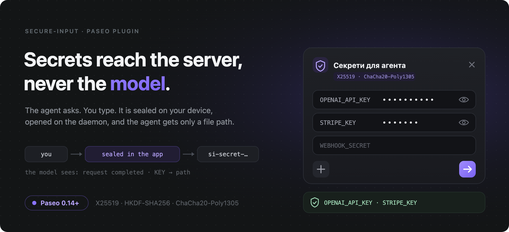
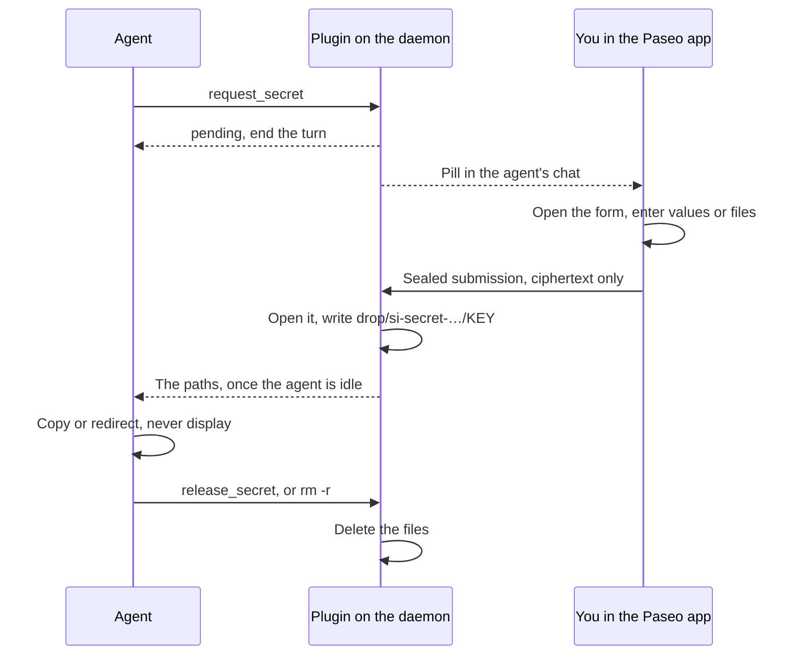

secure-input is a [Paseo](https://paseo.sh) plugin: an agent asks you for a password, an API key, a token or a whole credentials file in a form in the Paseo app instead of in the chat. The app seals what you enter, the daemon writes each value to a short-lived file that only your OS user can read, and the agent gets only the paths, with a skill that has it move each file's content without reading it (which holds as far as the agent follows the skill). The texts of the pill, the form and the settings screen are in Ukrainian only.

## Install

Paseo **0.14.0-beta.1 or later** on the daemon and in every app you answer from: an older app shows no pill, and `paseo plugin ls` cannot tell you. Paseo 0.14.0-beta.1 is a pre-release. The daemon needs Node.js 22.12 or later; macOS and Linux are declared supported, and live validation has been on macOS. Check both versions:

```bash
paseo daemon status          # daemonVersion
/usr/libexec/PlistBuddy -c 'Print :CFBundleShortVersionString' /Applications/Paseo.app/Contents/Info.plist   # the macOS app
```

Enable plugins under **Settings → Plugins → Enable plugins** (`pluginsEnabled` in the daemon's `config.json`), and give agents Paseo's own tools, which bring this plugin's with them. A fresh home of Paseo 0.14.0-beta.1 has that off; the setting applies to sessions that open afterwards:

```bash
paseo daemon config set daemon.mcp.injectIntoAgents true
```

| Source | Command |
|---|---|
| [Plugin directory](https://paseo.sh/plugins), the reviewed version, once the plugin is listed there | `paseo plugin add dutchakdev/secure-input` |
| npm, the newest release, also before the directory has reviewed it | `paseo plugin install npm:paseo-plugin-secure-input` |

`paseo plugin ls` then shows `secure-input` as `running`; `paseo plugin update secure-input` pulls later releases, and `paseo plugin remove secure-input` leaves the data directory behind.

Link the skill from a clone: Paseo hands no plugin's skill to agents, and the installed copy moves at every update. Agents that read `~/.agents/skills` take it from there; Claude Code reads `~/.claude/skills`:

```bash
git clone https://github.com/dutchakdev/paseo-plugin-secure-input.git
cd paseo-plugin-secure-input
mkdir -p ~/.agents/skills ~/.claude/skills
ln -sn "$PWD/skills/secure-input" ~/.agents/skills/secure-input
ln -sn ../../.agents/skills/secure-input ~/.claude/skills/secure-input
```

`ln -sn` replaces nothing: a name that is taken fails with `File exists` or, if it is a real directory, gets the link inside it; look with `ls -ld` first.

Then, on each device you answer from, open **Secure input** in the plugin's settings and press «Перевірити», which seals a submission of the largest size and has the plugin open it. Answer over the relay or Tailscale: a direct LAN connection with a password is not encrypted.

## How it works



The form shows no reason: the agent says why it asks in its own message. Deletion also runs without the agent ([When files go](#when-files-go)).

## What the agent gets

The agent has four tools beside Paseo's own: `request_secret` (named keys, or none; it answers `"status": "pending"`, and the paths follow in a message), `request_status`, `cancel_request` and `release_secret`, which agents see as `mcp__paseo__request_secret`, `mcp__paseo__request_status`, `mcp__paseo__cancel_request` and `mcp__paseo__release_secret`. A text value is one line of at most 64 KiB; a file is at most 128 KiB, binary included, checked as JSON or PEM when the agent asks for that. One pending request per agent; a request nobody answers expires after 8 hours. The skill holds the input and the rules the agent follows.

## What you see

A pill in the agent's chat holds the key names, never a value: «Секрет для агента» or «Секрети для агента» while it waits for you, green «Передано» once delivered and grey once the files are gone, struck through when declined, cancelled, expired or refused, and red «Підозріле подання» when a second, different submission came after delivery. Pressing the waiting pill opens the form over the chat: a hidden row per key with an eye to show it, dim names on optional keys, **+** for a row of your own (the paperclip makes it a file row), ✕ at the top to decline. A form holds at most 32 rows, including yours; → stays disabled while a required field or a row you added is incomplete, or while there is nothing to send. Closing the form any other way declines nothing and throws away what you typed. A file row takes a file picked or dropped on the desktop, or pasted on the desktop and the phone (Paseo gives plugins no file picker there); the plugin reads no clipboard. The form shows neither the agent's reason nor its labels.

**Secure input**, in the plugin's settings, runs «Перевірити», shows the sets on the daemon and the requests that wait («Секрети на сервері», «Запити, що чекають», «Помилки»), and has «Видалити всі файли секретів зараз», which tries to delete every set; some may already be gone when «Не вдалося видалити» appears, so check «Секрети на сервері» for what remains.

## When files go

Each delivery is `<data>/drop/si-secret-<requestId>/` with a file per key you filled in. The plugin tries to delete it at the first of these; a crash or a failed removal can leave files behind ([SECURITY.md](SECURITY.md#crashes-stops-and-restarts)):

- The agent calls `release_secret`, or deletes the directory itself.
- The end, with any outcome, of the agent's turn that its delivery message starts.
- 15 minutes after the write; on a machine that slept through that, within a minute of waking.
- The plugin starts, and sweeps `drop/`.
- The plugin stops, and tries to sweep `drop/`.
- You press «Видалити всі файли секретів зараз» in the settings.

An agent busy for more than 15 minutes after you submit loses the files at their deadline and, once idle, is told to ask again.

## Security

What you enter leaves the app only sealed to a one-time key of the request. The plugin stores submitted values only under `drop/` and leaves them out of its tool results, messages and logs; plaintext also exists for a while in app and daemon memory, and a failed write can leave staging files under `drop/`. Any process of your OS user can read a file while it exists, the agent included: what keeps the value out of the model is the skill's rule and the plugin leaving values out of its outputs. A harness rule that refuses file-reading tools on `si-secret-` paths blocks accidental reads through those tools only, not reads through the shell or from the destination. On Paseo 0.14.0-beta.1, a local process with access to the daemon can impersonate an agent: create a request in its chat, and look at, cancel or release its requests. The plugin cannot verify that the named agent made the call; only Paseo can close that. Provide a secret only for a task and destination you recognise. [SECURITY.md](SECURITY.md) describes the threat model and known limitations.

## When something is wrong

| Symptom | Cause and fix |
|---|---|
| The agent says it has no `request_secret` tool | `daemon.mcp.injectIntoAgents` is off ([Install](#install)); the provider's configuration switches Paseo's tools off; or the session opened before the plugin ran. A Codex agent may have to look in `ALL_TOOLS` |
| The agent reports `the plugin did not start (…)` | The start-up failed and the tools refuse until it succeeds. «Плагін» reads «Не запустився» with the reason, and so does `paseo plugin logs secure-input`: for example the data directory, `${PASEO_HOME:-~/.paseo}/secure-input`, or `drop/` in it, is not a private directory of your user. Remove the cause and reload the plugin. `the plugin is busy; retry in a few seconds` is a disk that stalls: nothing was done, and the agent can ask again |
| No pill in the chat, or no **Secure input** screen | The app is older than the plugin requires ([Install](#install)), or the plugin does not run: `paseo plugin ls`, `paseo plugin logs secure-input`. The plugin retries a pill that did not land; «Помилки» shows it meanwhile |
| The agent stops to ask for permission | Your harness may ask before plugin calls and file transfers. Approve only when the task and destination match what you authorised |
| The agent never continued after you submitted | Its message waits until the daemon says the agent is idle; [SECURITY.md](SECURITY.md#crashes-stops-and-restarts) says how long and how it can be lost. Tell the agent to continue: it can call `request_status` |
| «Секрети на сервері» is red | Something in `drop/` could not be deleted, and the plugin retries ([SECURITY.md](SECURITY.md#crashes-stops-and-restarts)). Press «Видалити всі файли секретів зараз», or delete `drop/` by hand |

## Development

Running from a checkout, the tests, the documents they hold to the code, and releases: [CONTRIBUTING.md](CONTRIBUTING.md). [CHANGELOG.md](CHANGELOG.md) lists what each release changed.

## License

MIT, see [LICENSE](LICENSE).
